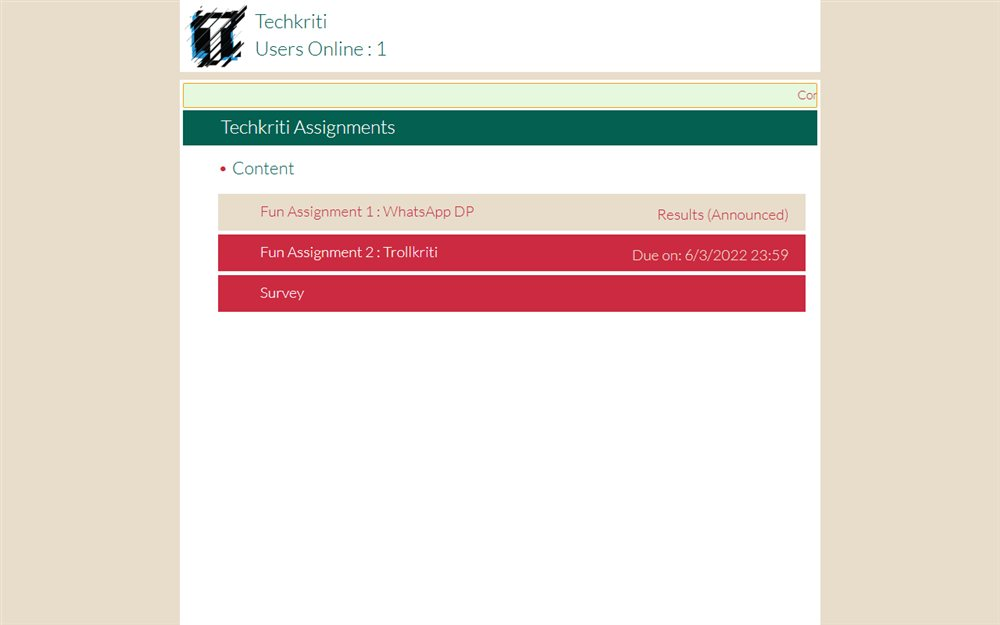

# Techkriti '21 - Pages

Hand-built pages from Techkriti 2021: the main landing page, a fun page, a survey and an assignment page.

**[Open the live site](https://ajeet-iitk.github.io/techkritiY21/)**

## What it does

A set of static pages put together for Techkriti 2021 - the festival landing page plus the supporting pages that were needed at the time: a fun page, a survey form and an assignment page.

## Pages

| File | Purpose |
| --- | --- |
| `index.html` | Festival landing page |
| `Fun.html` | Fun / interactive page |
| `Survey.html` | Survey form |
| `Assignment2.html` | Assignment page |

## Run locally

Open `index.html`, or use the hosted copy:

<https://ajeet-iitk.github.io/techkritiY21/>

---

Part of [my collection of small projects](https://github.com/Ajeet-iitk).
